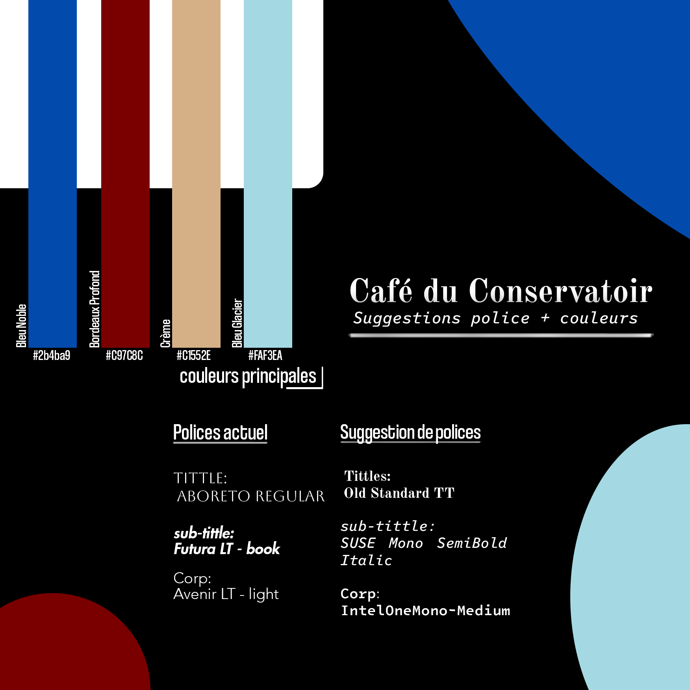

# front_end_coffee_Shop



## Lil infos

Working on it 

## Polices

| Rôle | Police | Fichier |
| --- | --- | --- |
| Titre | Old Standard TT Bold | `font/OldStandardTT-Bold.ttf` |
| Sous-titre | SUSE Mono Medium Italic | `font/SUSEMono-MediumItalic.ttf` |
| Corps | Intel One Mono Medium | `font/IntelOneMono-Medium.ttf` |

```css
@font-face {
  font-family: "Old Standard TT";
  src: url("font/OldStandardTT-Bold.ttf") format("truetype");
  font-weight: 700;
  font-style: normal;
}

@font-face {
  font-family: "SUSE Mono";
  src: url("font/SUSEMono-MediumItalic.ttf") format("truetype");
  font-weight: 500;
  font-style: italic;
}

@font-face {
  font-family: "Intel One Mono";
  src: url("font/IntelOneMono-Medium.ttf") format("truetype");
  font-weight: 500;
  font-style: normal;
}
```

<p style="font-family: 'Old Standard TT'; font-weight: 700; font-size: 40px;">Café du Conservatoire</p>
<p style="font-family: 'SUSE Mono'; font-weight: 500; font-style: italic; font-size: 22px;">Suggestions police + couleurs</p>
<p style="font-family: 'Intel One Mono'; font-weight: 500; font-size: 18px;">Le café ouvre à 8h, du mardi au samedi.</p>

